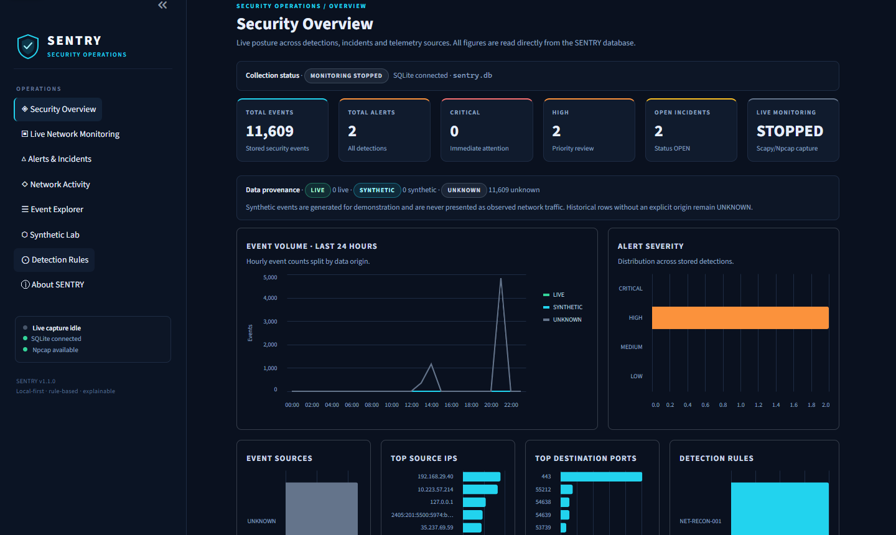
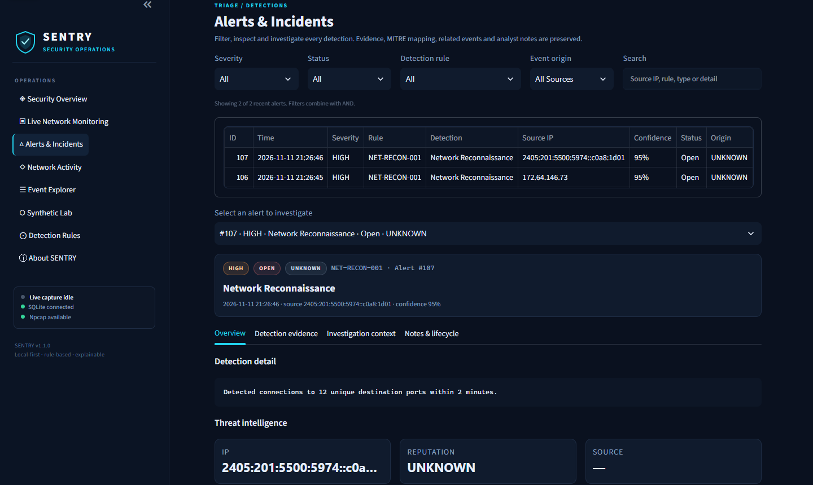
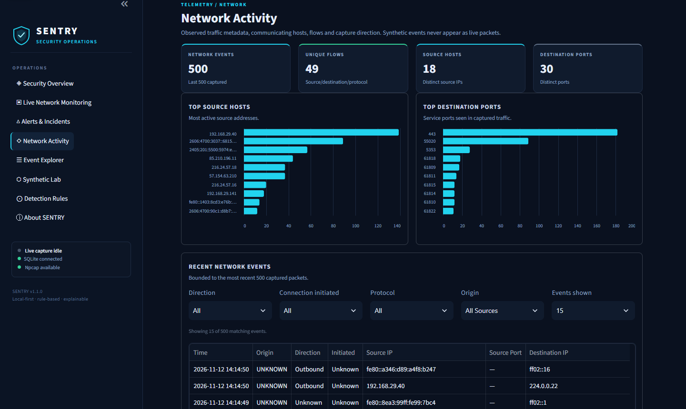
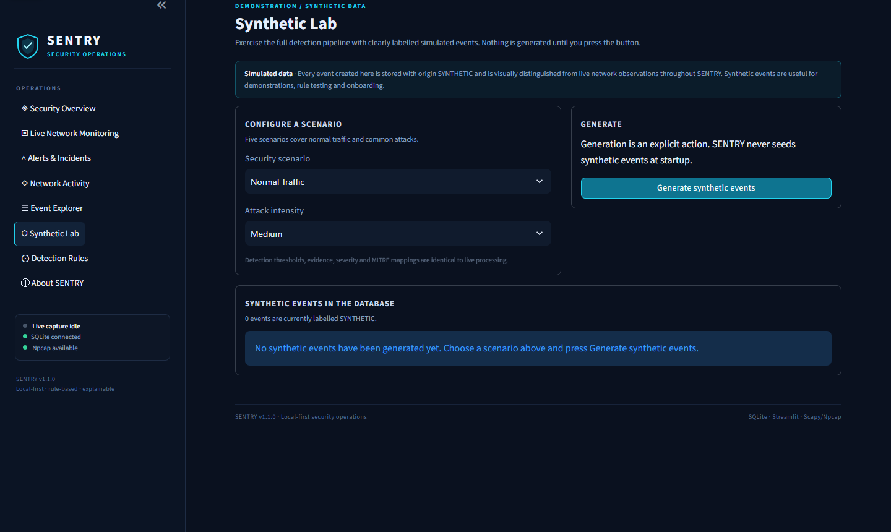
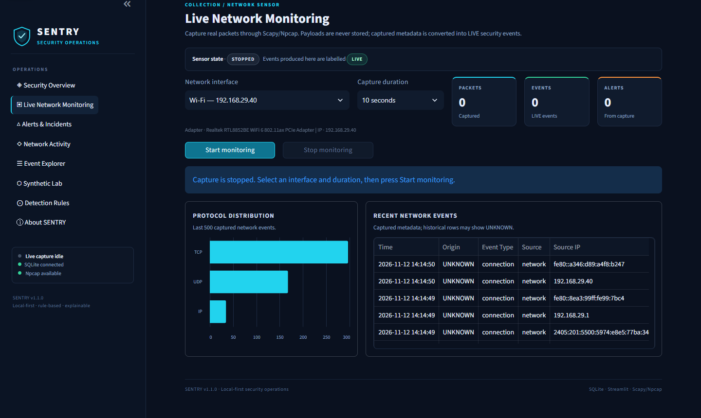
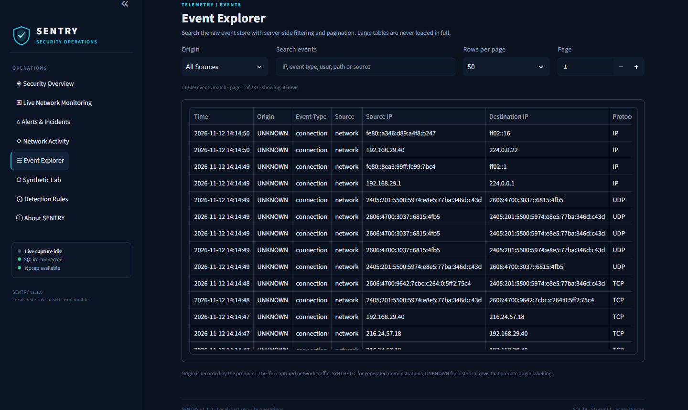
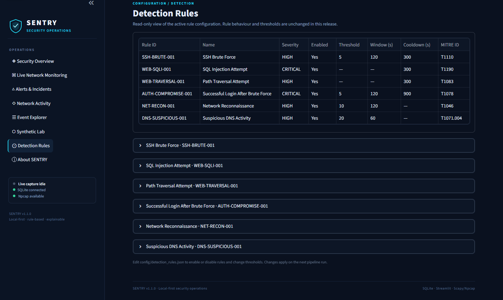

# 🛡️ SENTRY — Security Monitoring & Threat Detection Platform

SENTRY is a self-contained, rule-based SIEM with optional threat-intelligence
enrichment, statistical anomaly scoring, live network capture, and an analyst
dashboard. Every alert explains **which rule fired, which exact events and
conditions triggered it, and why that behaviour is suspicious**.

It needs no paid service, no cloud account, and no external log pipeline: you
can run a complete detect → alert → investigate loop locally.

**Version 1.1.0** · Python 3.10+ · Streamlit · SQLite · Scapy/Npcap

---

## Features

- **Synthetic event generation** — normal traffic, SSH brute force, SQL
  injection, path traversal, mixed campaigns, four intensity levels. Created
  only from the explicit **Synthetic Lab** action and stored with origin
  `SYNTHETIC`.
- **Honest data provenance** — every event records whether it is `LIVE`
  (captured from real traffic), `SYNTHETIC` (generated) or `UNKNOWN`
  (historical rows that predate origin labelling). Filters and badges appear
  throughout the dashboard; origins are never guessed from IP addresses.
- **Professional SOC dashboard** — dark operations shell with eight working
  pages: Security Overview, Live Network Monitoring, Alerts & Incidents,
  Network Activity, Event Explorer, Synthetic Lab, Detection Rules and About.
- **Real network monitoring** — Scapy/Npcap capture, interface selection,
  fixed or continuous durations, IPv4/IPv6/TCP/UDP metadata and DNS queries.
  Payloads are never stored. Batched processing and responsive STOP.
- **Detection rules** — SSH brute force, SQL injection, path traversal,
  successful login after brute force, network reconnaissance, suspicious DNS
  activity. Thresholds are editable in `config/detection_rules.json`.
- **Explainable alerts** — rule, description, MITRE ATT&CK mapping, expected
  vs. observed conditions, correlation window, exact triggering events,
  generated explanation, labelled confidence, recommended actions.
- **Threat intelligence** — local feed, optional AbuseIPDB provider, SQLite
  cache, private/reserved address handling. Unknown stays unknown.
- **Optional anomaly layer** — statistical baseline with per-feature
  deviation reasons. Off by default; never replaces rule detection.
- **Alert lifecycle** — OPEN, INVESTIGATING, RESOLVED, FALSE_POSITIVE, analyst
  notes, recommended actions, audit log.
- **Persistent alert deduplication** — per-rule cooldowns keyed by rule, source
  and target/account/signature, stored in SQLite and surviving restarts.
  Suppressed detections keep their events; the cooldown anchor is the last
  emitted alert.
- **Investigation workspace** — ±120 s context correlation, network evidence,
  network summary, threat-intelligence panel, alert search.
- **Optional notifications** — JSON webhook with severity filter and cooldown.
- **HTTP ingestion API** — submit events to `POST /api/events` and
  `POST /api/events/batch`.

---

## Screenshots

Captured from a real local run against the preserved database
(`docs/screenshots/`). Live monitoring was idle in these captures.

### Security overview — real database metrics, origin split and charts



### Alerts & incidents — filters, origin labels and investigation workspace



### Network activity — hosts, ports and bounded event tables



### Synthetic Lab — explicit generation with a persistent simulated-data warning



### Live monitoring — interface, duration, run state and recent events



### Event Explorer — server-side origin/search filters and pagination



### Detection Rules — active configuration and MITRE mapping



---

## Data provenance

SENTRY separates demonstration data from genuine observations at the event
model and database level:

| Origin | Meaning | Producer |
|---|---|---|
| `LIVE` | Captured from real network traffic | `sensors/network_sensor.py` |
| `SYNTHETIC` | Generated for demonstration and rule testing | `core/generator.py` via Synthetic Lab |
| `UNKNOWN` | Historical row whose origin cannot be established | Existing databases before v1.1 |

`SecurityEvent.event_origin` is persisted in `events.event_origin`, and the
origin of the triggering events is carried onto `alerts.event_origin`. The
dashboard exposes **All Sources / Synthetic / Live / Unknown** filters in
Alerts, Network Activity and Event Explorer, and labels every table with text
(SYNTHETIC is cyan, LIVE is green, UNKNOWN is grey — never colour alone).

Synthetic events are only created after an explicit **Generate synthetic
events** action. SENTRY never seeds demonstration events on startup and never
presents generated activity as a network observation. Detection thresholds,
severity, confidence, evidence and MITRE mappings are identical for both
origins.

To keep demonstrations completely separate from production data, point SENTRY
at another database file (the schema is created automatically):

```powershell
$env:SENTRY_DB_PATH = "demo.db"
.\run_sentry.bat
```

---

## Architecture

```
 Synthetic generator ─┐  event_origin=SYNTHETIC
 Live network sensor ─┼─► SecurityEvent ─► Detection engine ─► Alerts ─► SQLite ─► Dashboard
 HTTP ingestion API  ─┘  event_origin=UNKNOWN      │ evidence + origin       │
                                                   ▼                         ▼
                                         Threat intel / anomaly      Notifications (optional)
```

| Component | File |
|---|---|
| Models | `core/models.py` |
| Log parser / normalizer | `core/parser.py`, `core/normalizer.py` |
| Synthetic generator | `core/generator.py` |
| Detection engine | `core/detector.py` |
| Threat intelligence | `core/threat_intel.py` |
| Anomaly layer | `core/anomaly.py` |
| Notifications | `core/notifications.py` |
| SQLite persistence | `core/database.py` |
| Pipeline | `core/pipeline.py` |
| Network sensor | `sensors/network_sensor.py` |
| Dashboard | `app_v3.py` |
| Windows launcher | `run_sentry.bat` |
| Ingestion API | `api.py` |
| Rule configuration | `config/detection_rules.json` |
| Threat feed | `config/threat_feed.json` |

More detail: [docs/ARCHITECTURE.md](docs/ARCHITECTURE.md) and
[docs/DETECTIONS.md](docs/DETECTIONS.md).

---

## Installation

### 1. Python environment

```powershell
git clone <your-repository-url> sentry
cd sentry
python -m venv .venv
.\.venv\Scripts\Activate.ps1
pip install -r requirements.txt
```

Python 3.10+ is required. SENTRY v1.1.0 was developed and verified on
Windows 11 with Python 3.14.7, Streamlit 1.63.0 and Scapy 2.7.0.
The Linux/macOS steps below are provided but were not verified in this
release.

Linux/macOS:

```bash
python3 -m venv .venv
source .venv/bin/activate
pip install -r requirements.txt
```

### 2. Packet capture (network monitoring only)

- **Windows:** install [Npcap](https://npcap.com/) with "WinPcap API
  compatibility mode". Without it, the interface list is empty and a clear
  error is shown; synthetic detection still works.
- **Linux:** install `libpcap` and grant capture capability:
  `sudo setcap cap_net_raw,cap_net_admin=eip $(readlink -f .venv/bin/python)`
- **macOS:** install `libpcap` (usually present) and capture with appropriate
  privileges.

Only monitor networks you are authorized to monitor.

---

## Running SENTRY

### Windows one-click launcher (verified)

After cloning the repository, double-click **`run_sentry.bat`** (or run it from
PowerShell). It:

1. checks for Python 3.10+ and explains what to install if it is missing;
2. creates `.venv` on first run;
3. installs `requirements.txt` only when the environment is missing packages or
the requirements file changed;
4. checks for Npcap and explains that it is only needed for live capture;
5. starts Streamlit and opens the browser normally.

Keep the launcher window open while SENTRY runs; press **Ctrl+C** there to stop
it. The launcher never creates, deletes or resets `sentry.db` and never
generates events for you.

### Manual launch (Windows, verified)

```powershell
.\.venv\Scripts\python.exe -m streamlit run app_v3.py
```

### Linux/macOS (manual, not verified in v1.1.0)

SENTRY runs on Python 3.10+; the following is provided as guidance but was not
tested for this release, so no Linux launcher is shipped.

```bash
python3 -m venv .venv
source .venv/bin/activate
pip install -r requirements.txt
python -m streamlit run app_v3.py
```

Open <http://localhost:8501> on any platform.

1. Open **Synthetic Lab** and generate a scenario, or start **Live Network
   Monitoring** on an interface.
2. Review **Alerts & Incidents**, filter by severity, status, rule or origin,
   and read **Detection evidence** for the selected alert.
3. Inspect investigation context, threat intelligence and related events.
4. Save analyst notes, recommended action, and update status.

The existing `sentry.db` is migrated automatically on first start. The
migration is additive: `event_origin` is added to `events` and `alerts`
without deleting events, alerts, notes, status or investigations. Historical
rows keep `NULL` and are shown as **UNKNOWN**, never reclassified by guessing.
Legacy alerts without evidence still display "Detection evidence is not
available for this historical alert."

### Database environments

SENTRY keeps development history, demonstration data and automated-test data
in separate SQLite files.

| Environment | Default path | Selection |
|---|---|---|
| Development | `sentry.db` | The default; your existing historical data |
| Demonstration | `sentry_demo.db` | Set `SENTRY_DB_PATH` before launching |
| Automated tests | Temporary pytest file | Created automatically per test, outside the project |

Relative database paths are resolved against the SENTRY project root, not the
shell's current directory. Absolute paths, including Windows drive paths, are
used as supplied. A missing database is created with the complete current
schema and no events; synthetic data is only created from **Synthetic Lab**.

Run the demonstration environment in PowerShell:

```powershell
$env:SENTRY_DB_PATH = "sentry_demo.db"
.\run_sentry.bat
```

That database is created on first use and keeps its demonstration events
across restarts. It never reads or writes `sentry.db`. To return to the
development database, remove the variable or open a new terminal:

```powershell
Remove-Item Env:SENTRY_DB_PATH
```

The HTTP API uses the same `SENTRY_DB_PATH` selection. Pytest always injects an
isolated temporary database, so running the suite never touches either local
database.

### Optional HTTP API

```powershell
.\.venv\Scripts\python.exe -m uvicorn api:app --reload
```

```bash
curl -X POST http://127.0.0.1:8000/api/events/batch \
  -H "Content-Type: application/json" \
  -d '{"events":[
    {"source":"authentication","event_type":"login_failure","source_ip":"45.33.32.156","username":"admin"},
    {"source":"authentication","event_type":"login_failure","source_ip":"45.33.32.156","username":"admin"},
    {"source":"authentication","event_type":"login_failure","source_ip":"45.33.32.156","username":"admin"},
    {"source":"authentication","event_type":"login_failure","source_ip":"45.33.32.156","username":"admin"},
    {"source":"authentication","event_type":"login_failure","source_ip":"45.33.32.156","username":"admin"}
  ]}'
```

---

## Configuration

`config/detection_rules.json` controls each rule:

```json
{
  "SSH-BRUTE-001": {"enabled": true, "threshold": 5, "window_seconds": 120},
  "NET-RECON-001": {"enabled": true, "threshold": 10, "window_seconds": 120},
  "DNS-SUSPICIOUS-001": {"enabled": true, "threshold": 20, "window_seconds": 60}
}
```

Missing or invalid values fall back to the documented defaults.

Environment variables (see `.env.example`; never commit real keys):

| Variable | Purpose |
|---|---|
| `SENTRY_DB_PATH` | SQLite path (default `sentry.db`); point at a separate file for a demonstration store |
| `SENTRY_ANOMALY_ENABLED` | Enable the statistical anomaly layer (`1`/`true`) |
| `SENTRY_WEBHOOK_URL` | JSON webhook for notifications (empty = disabled) |
| `SENTRY_NOTIFY_MIN_SEVERITY` | Minimum severity to notify (default `HIGH`) |
| `SENTRY_NOTIFY_COOLDOWN_SECONDS` | Per rule/source notification cooldown |
| `ABUSEIPDB_API_KEY` | Optional IP reputation provider |

`config/threat_feed.json` is a local list of IPs you have independently
confirmed as malicious or suspicious. An empty feed is normal.

---

## Detection rules

| Rule ID | Detection | Severity | Default condition |
|---|---|---|---|
| `SSH-BRUTE-001` | SSH brute force | HIGH | 5 failures / 120 s |
| `WEB-SQLI-001` | SQL injection | CRITICAL | SQL signature in request |
| `WEB-TRAVERSAL-001` | Path traversal | HIGH | `../` sequence in request |
| `AUTH-COMPROMISE-001` | Login after brute force | CRITICAL | success after 5 failures / 120 s |
| `NET-RECON-001` | Network reconnaissance | HIGH | 10 unique ports / 120 s |
| `DNS-SUSPICIOUS-001` | Suspicious DNS | HIGH | 20 unique domains / 60 s |
| `ML-ANOMALY-001` | Statistical anomaly | MEDIUM | z-score ≥ 4 vs baseline (optional) |

Full detail, evidence fields and suppression behaviour:
[docs/DETECTIONS.md](docs/DETECTIONS.md).

Alerts are deduplicated persistently with per-rule cooldowns: **300 s** for
SSH brute force, SQL injection and path traversal (fingerprinted per account,
endpoint+signature, and decoded target respectively), **900 s** for successful
login after brute force (per account), and the existing **120 s** per-source
window for network reconnaissance. A different source, account, endpoint or
target is a new incident and alerts immediately.

**Confidence values are heuristic signal strength, not calibrated
probabilities. Anomaly scores are deviations, not probabilities of malicious
activity. Threat-intel "unknown" means no source has data.**

---

## Tests

```powershell
.\.venv\Scripts\python.exe -m pytest tests -q
```

Current baseline: **171 tests passing**. Coverage includes every rule
(positive, below-threshold, out-of-window, missing IP/port), evidence contents,
persistence, schema migration, legacy alerts, malformed evidence,
pipeline/database wiring, rule configuration, DNS detection, threat-intel
classification and caching, anomaly scoring, notification filtering/cooldown,
sensor packet conversion and batching, audit logging, end-to-end generated
campaigns, and event-origin propagation from generator/sensor through alert
storage and origin-filtered queries.

UI verification uses Streamlit's `AppTest` to load all eight pages, generate a
synthetic attack scenario in a temporary database, filter synthetic alerts,
change alert lifecycle state, start/stop live capture, and exercise Event
Explorer filtering. Tests use temporary databases; your `sentry.db` is never
modified by the suite.

---

## Data and privacy

Stored: normalized event metadata, alerts, evidence, reputation results,
analyst notes, audit entries. Not stored: packet payloads.

`sentry.db`, `sentry_demo.db`, SQLite sidecar files, logs, reports, `.env` and
virtual environments are git-ignored. Back up `sentry.db` before deliberately
deleting it; removing it erases collected events and investigations. See
[SECURITY.md](SECURITY.md).

---

## Known limitations

- Rule thresholds are generic and not tuned per deployment; tune them in
  `config/detection_rules.json`.
- SQL injection and path-traversal rules inspect request URLs only. Request
  bodies and POST data are not captured or analysed.
- Path-traversal decoding is capped at two URL-decoding passes; payloads
  encoded three or more times are not decoded.
- Deduplication suppresses the same fingerprint inside its cooldown. It does
  not merge distinct attacks, but a differently encoded request that decodes
  to the same target is treated as the same incident.
- No user authentication or role-based access control; run it on localhost or
  behind your own access control.
- The sensor captures packet headers and DNS query names only. It does not
  reassemble streams or inspect payloads.
- The anomaly layer is deliberately simple (per-source feature deviation). It
  needs normal activity before it can score anything and is disabled by
  default.
- No user authentication or role-based access control yet; the dashboard is
  intended for local, single-analyst use.
- Windows is the primary tested platform. Linux/macOS capture depends on
  libpcap and capture permissions.
- Zero alerts during ordinary browsing can be correct: network reconnaissance
  requires 10 distinct ports from one source within two minutes.

---

## Roadmap

See [ROADMAP.md](ROADMAP.md) for planned work. v1.1 completes the professional
dashboard and synthetic/live provenance work; Windows Event Log ingestion,
report exports, threat-intelligence integrations and multi-user deployment
remain future work.

## Contributing and security

Contributions are welcome — read [CONTRIBUTING.md](CONTRIBUTING.md) before
opening a pull request. Report vulnerabilities privately as described in
[SECURITY.md](SECURITY.md); please do not open public issues for them.

## License

MIT — see [LICENSE](LICENSE).
