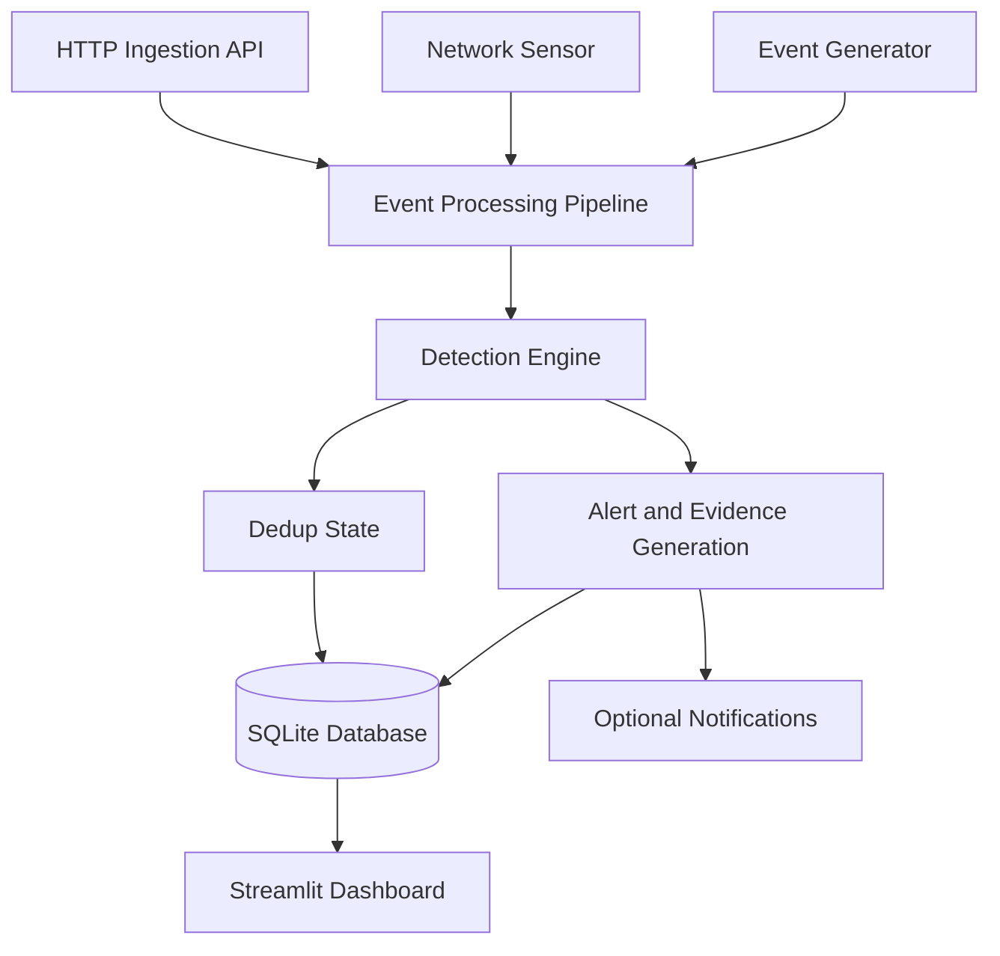

# SENTRY Architecture



Alerts and their structured evidence are written to SQLite. The detection
engine also reads and writes the persistent fingerprint table (`alert_dedup`)
so repeated processing of one detection is suppressed for that rule's
cooldown; NET-RECON-001 keeps its original 120-second per-source state in
`detection_state`.

Database paths are resolved centrally in `core/database.py`. Explicit paths
take precedence, then `SENTRY_DB_PATH`, then the development database at
`sentry.db` in the project root. Relative paths are project-relative so a
launch from another directory cannot silently create a second database. The
demonstration environment uses `SENTRY_DB_PATH=sentry_demo.db`; pytest injects
a temporary database for every test.

Every normalized event carries `event_origin`. The generator labels its
output `SYNTHETIC`, the network sensor labels captured packets `LIVE`, and any
producer that does not state an origin leaves it `NULL`, which the dashboard
presents as `UNKNOWN`. The pipeline copies the origin of the triggering
events onto the resulting alert (mixed or absent origins become `UNKNOWN`).
This is metadata only: detection thresholds, evidence, severity, confidence
and deduplication are unchanged.

```
 Synthetic generator ─┐ event_origin=SYNTHETIC
 Live network sensor ─┼─► Normalized SecurityEvent ─► Detection engine ─► Alerts
 HTTP ingestion API  ─┘ event_origin=NULL                │ evidence + origin  │
                                                         ▼                   ▼
                                              Threat intelligence     SQLite (sentry.db)
                                              Anomaly layer                │
                                              Notifications          Streamlit dashboard
```

## Components

| Component | File | Responsibility |
|---|---|---|
| Models | `core/models.py` | `SecurityEvent` and `Alert` (evidence, threat intel, event origin) |
| Parser | `core/parser.py` | auth.log / access.log → events |
| Normalizer | `core/normalizer.py` | external input → events, UTC-naive timestamps |
| Generator | `core/generator.py` | synthetic normal and attack scenarios |
| Sensor | `sensors/network_sensor.py` | Scapy/Npcap capture → events, DNS queries, batching |
| Detector | `core/detector.py` | rule engine, configurable thresholds, evidence |
| Threat intel | `core/threat_intel.py` | local feed, optional AbuseIPDB, cache |
| Anomaly | `core/anomaly.py` | statistical baseline and deviation scoring |
| Notifications | `core/notifications.py` | optional JSON webhook with cooldown |
| Database | `core/database.py` | persistence, migration, audit, caches |
| Pipeline | `core/pipeline.py` | orchestration and enrichment |
| Dashboard | `app_v3.py` | monitoring and investigation UI |
| API | `api.py` | FastAPI event ingestion |

## Data model

| Table | Purpose |
|---|---|
| `events` | Normalized events (auth, web, network, DNS) |
| `alerts` | Alerts with severity, status, evidence JSON, threat intel JSON |
| `detection_state` | Last alert per (rule, source IP) for persistent suppression |
| `intel_cache` | Cached reputation results with last-checked time |
| `audit_log` | Analyst status/investigation actions |
| `notification_state` | Last notification per (rule, source IP) |
| `ml_baseline` | Stored anomaly baseline (single row) |

## Detection flow

1. Events arrive from the generator, log parser, sensor or API.
2. `DetectionEngine.detect` runs enabled rules in a fixed order.
3. Each rule correlates events by source IP inside a configured window.
4. Firing rules build evidence: rule identity, MITRE mapping, conditions,
   observed values, window, exact triggering events, explanation, actions.
5. The pipeline optionally enriches alerts with reputation and anomaly findings.
6. Alerts and events are persisted; notifications are sent if configured.
7. The dashboard displays evidence separately from investigation context.

## Trust boundaries

- Rule confidence is a signal-strength value, not a probability.
- Anomaly scores measure deviation, not maliciousness.
- Threat intelligence "unknown" means no source has data — not benign.
- Synthetic events are generated locally and labelled as synthetic.
